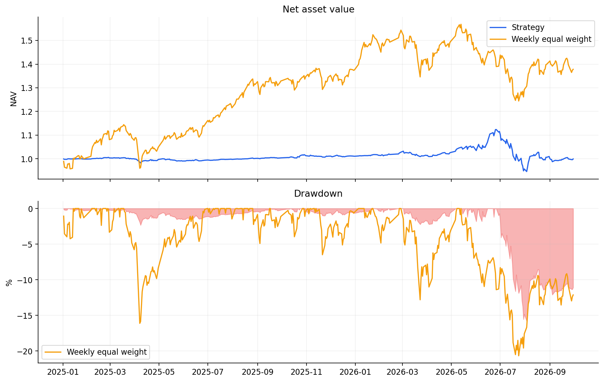
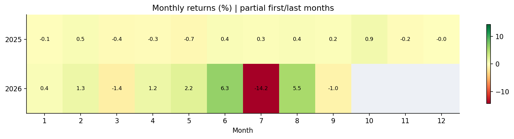
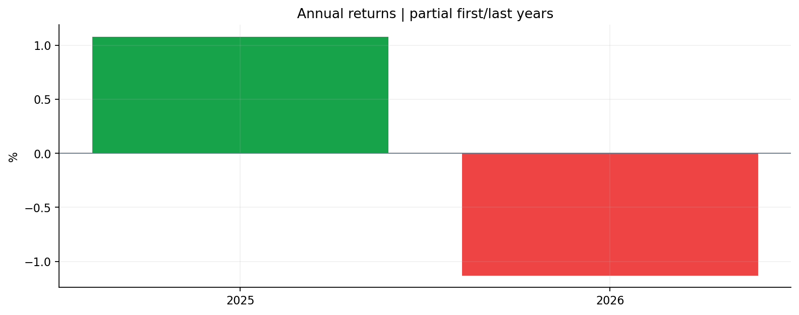
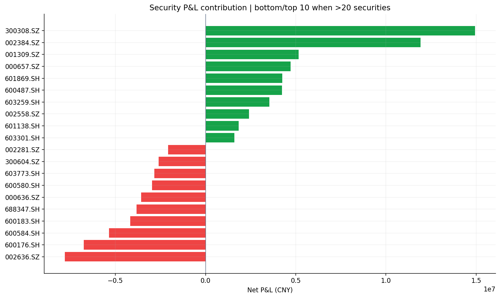
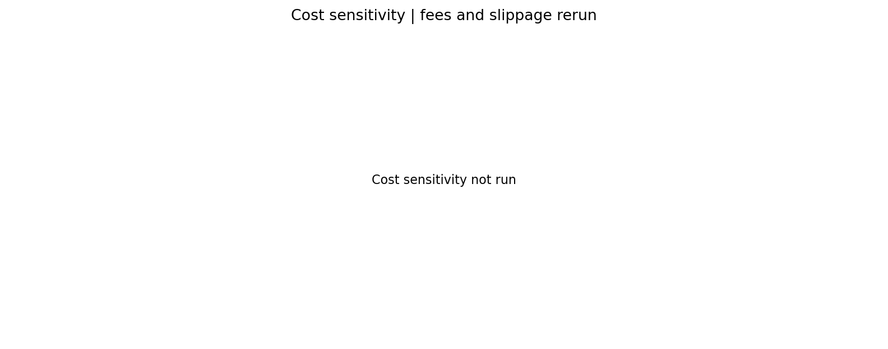

# 回测报告

## 绩效指标

- 累计收益: -0.000643
- 年化收益: -0.000369
- 年化波动率: 0.084296
- 夏普（无风险利率0）: 0.037585
- 最大回撤: -0.158053
- 最终权益: 999357210.972576

## 收益来源

- 持仓及执行毛损益（按实际成交路径回加成本）: 3,697,702.44
- 显式费用: 1,805,874.65
- 已计入成交价的滑点: 2,534,616.82
- 净损益: -642,789.03
- 毛损益 − 显式费用 − 滑点 = 净损益；毛损益并非无成本策略独立运行结果。
- 未提供基准，现金机会成本和超额收益不可计算。

## 交易质量与容量

- orders: 4522.000000
- orders_with_fill_ratio: 0.916188
- value_weighted_fill_ratio_at_signal_prices: 0.057145
- max_single_position_weight: 0.059654
- annual_one_way_turnover: 1.454422
- max_filled_adv_ratio: 0.011053
- partial_capacity_or_cash: 3293 单
- filled: 820 单
- slippage_outside_range: 311 单
- one_price_bar: 39 单
- hypothetical_settlement: 30 单
- zero_amount: 11 单
- estimated_limit_down: 10 单
- factor_jump: 5 单
- estimated_limit_up: 3 单

容量基于历史成交额代理，不代表开盘实际容量。成交比例按信号时点金额加权，避免开盘跳空扭曲成交率。

## 稳定性与验证

- annual_returns.csv / monthly_returns.csv：年度/月度复合收益，首尾期可能不完整。
- rolling_returns.csv：20/60/252观察日滚动收益，窗口不足留空。
- sensitivity.csv：真实重跑的成本情景和预先配置的参数变化。未配置的分析不视为已完成。
- validation.csv：按时间分段或滚动前推的固定参数表现；每段独立资金启动、历史数据仅预热，不自动挑选参数。
- 此数据历史已被查看，分段只是历史诊断，不宣称未见样本外。任何参数调整后重新查看测试期都应登记为重复使用。

## 对照表现

- 基准总收益: 未提供；相对净值总收益: 未提供

## 模型与数据边界

- 原价×累计复权因子、成交额单位元均为待供应商确认假设；复权单位账户不是实际股份账户。
- 缺少历史ST、精确涨跌停和公司行为；采用近似成交限制，缺失持仓沿用旧价，可能高估权益。
- 费用为情景假设；无真实开盘容量、排队信息。未成交不等于策略撤销。
- 数据哈希、代码、配置和尝试记录随本次结果保存。

## 证券状态覆盖

- 清单未覆盖日期为UNKNOWN，不推断为NORMAL；未提供清单时不能宣称已经准确去除全部ST。
- 未知证券日数: 118458
- 已知正常证券日数: 2115941
- 排除证券日数: 76825
- 强制退出持仓日数: 41

## 按证券盈亏贡献

- 净贡献 = 期末持仓市值 + 卖出金额 − 买入金额 − 显式费用；滑点已在成交金额中，不能重复扣减。
- 全部证券贡献已与账户净损益自动对账；完整明细见security_contributions.csv。

| 证券 | 净贡献（元） | 初始资金收益贡献 |
| --- | --- | --- |
| 300308.SZ | 14,939,696.30 | 1.49% |
| 002384.SZ | 11,920,368.92 | 1.19% |
| 001309.SZ | 5,161,381.93 | 0.52% |
| 000657.SZ | 4,709,018.66 | 0.47% |
| 601869.SH | 4,251,440.86 | 0.43% |
| 600487.SH | 4,233,797.67 | 0.42% |
| 603259.SH | 3,531,714.30 | 0.35% |
| 002558.SZ | 2,413,806.82 | 0.24% |
| 601138.SH | 1,828,455.59 | 0.18% |
| 603301.SH | 1,592,078.41 | 0.16% |
| 002240.SZ | 1,580,883.78 | 0.16% |
| 001267.SZ | 1,434,522.16 | 0.14% |
| 301217.SZ | 1,319,790.33 | 0.13% |
| 600498.SH | 1,229,818.51 | 0.12% |
| 600118.SH | 1,212,770.70 | 0.12% |
| 688766.SH | 1,192,746.37 | 0.12% |
| 688072.SH | 1,155,690.07 | 0.12% |
| 002896.SZ | 1,121,548.54 | 0.11% |
| 688227.SH | 1,113,655.87 | 0.11% |
| 002409.SZ | 1,104,368.36 | 0.11% |
| 002371.SZ | 1,088,389.97 | 0.11% |
| 000678.SZ | 1,018,378.51 | 0.10% |
| 301377.SZ | 988,167.49 | 0.10% |
| 688257.SH | 902,800.44 | 0.09% |
| 003010.SZ | 894,757.29 | 0.09% |
| 688498.SH | 890,699.03 | 0.09% |
| 002190.SZ | 862,492.69 | 0.09% |
| 300548.SZ | 818,264.73 | 0.08% |
| 000833.SZ | 810,108.11 | 0.08% |
| 002734.SZ | 808,950.43 | 0.08% |
| 300342.SZ | 757,854.40 | 0.08% |
| 601126.SH | 743,204.74 | 0.07% |
| 300377.SZ | 717,593.46 | 0.07% |
| 603938.SH | 671,508.78 | 0.07% |
| 688313.SH | 649,633.37 | 0.06% |
| 002842.SZ | 625,371.48 | 0.06% |
| 002015.SZ | 620,439.95 | 0.06% |
| 688167.SH | 619,290.39 | 0.06% |
| 300442.SZ | 610,759.34 | 0.06% |
| 301362.SZ | 607,104.09 | 0.06% |
| 600162.SH | 566,070.00 | 0.06% |
| 301338.SZ | 549,706.58 | 0.05% |
| 002738.SZ | 530,485.43 | 0.05% |
| 001203.SZ | 528,477.15 | 0.05% |
| 002498.SZ | 508,368.64 | 0.05% |
| 002655.SZ | 499,250.96 | 0.05% |
| 002361.SZ | 498,388.40 | 0.05% |
| 002303.SZ | 471,910.51 | 0.05% |
| 688025.SH | 464,701.41 | 0.05% |
| 301018.SZ | 461,257.43 | 0.05% |
| 600664.SH | 454,014.17 | 0.05% |
| 300420.SZ | 452,776.21 | 0.05% |
| 688008.SH | 449,327.43 | 0.04% |
| 002370.SZ | 446,096.79 | 0.04% |
| 003041.SZ | 439,154.97 | 0.04% |
| 300033.SZ | 433,680.58 | 0.04% |
| 688627.SH | 423,461.30 | 0.04% |
| 300323.SZ | 409,505.69 | 0.04% |
| 603061.SH | 391,589.31 | 0.04% |
| 600410.SH | 380,625.85 | 0.04% |
| 002046.SZ | 343,436.74 | 0.03% |
| 300671.SZ | 317,734.76 | 0.03% |
| 002552.SZ | 311,368.46 | 0.03% |
| 605178.SH | 311,312.30 | 0.03% |
| 603121.SH | 308,037.08 | 0.03% |
| 002957.SZ | 307,775.25 | 0.03% |
| 688700.SH | 305,045.46 | 0.03% |
| 600143.SH | 296,506.28 | 0.03% |
| 300806.SZ | 296,332.76 | 0.03% |
| 601929.SH | 287,695.97 | 0.03% |
| 603588.SH | 275,767.14 | 0.03% |
| 601991.SH | 274,496.68 | 0.03% |
| 301312.SZ | 273,906.26 | 0.03% |
| 002378.SZ | 273,779.34 | 0.03% |
| 300703.SZ | 273,524.31 | 0.03% |
| 002031.SZ | 271,919.70 | 0.03% |
| 605376.SH | 262,981.04 | 0.03% |
| 688048.SH | 256,769.89 | 0.03% |
| 603662.SH | 256,712.19 | 0.03% |
| 001389.SZ | 255,469.85 | 0.03% |
| 002094.SZ | 250,854.21 | 0.03% |
| 688228.SH | 247,394.73 | 0.02% |
| 002402.SZ | 244,579.03 | 0.02% |
| 600909.SH | 240,777.40 | 0.02% |
| 301345.SZ | 240,157.23 | 0.02% |
| 300766.SZ | 239,222.79 | 0.02% |
| 601579.SH | 236,741.63 | 0.02% |
| 002208.SZ | 230,264.71 | 0.02% |
| 600711.SH | 226,385.86 | 0.02% |
| 603366.SH | 225,164.80 | 0.02% |
| 300810.SZ | 221,625.25 | 0.02% |
| 002988.SZ | 217,904.70 | 0.02% |
| 300759.SZ | 217,041.72 | 0.02% |
| 002651.SZ | 209,060.60 | 0.02% |
| 002518.SZ | 208,946.37 | 0.02% |
| 688068.SH | 208,454.52 | 0.02% |
| 600644.SH | 204,023.40 | 0.02% |
| 002471.SZ | 202,956.43 | 0.02% |
| 300822.SZ | 200,820.05 | 0.02% |
| 300065.SZ | 196,751.79 | 0.02% |
| 300528.SZ | 195,322.69 | 0.02% |
| 002826.SZ | 193,010.89 | 0.02% |
| 603226.SH | 192,544.79 | 0.02% |
| 600206.SH | 190,881.28 | 0.02% |
| 300751.SZ | 188,810.49 | 0.02% |
| 301200.SZ | 187,900.30 | 0.02% |
| 301108.SZ | 185,455.97 | 0.02% |
| 002882.SZ | 183,260.84 | 0.02% |
| 301183.SZ | 182,839.93 | 0.02% |
| 002165.SZ | 177,043.21 | 0.02% |
| 605580.SH | 176,681.28 | 0.02% |
| 002681.SZ | 174,367.22 | 0.02% |
| 688353.SH | 171,082.32 | 0.02% |
| 301292.SZ | 168,036.35 | 0.02% |
| 301079.SZ | 167,446.40 | 0.02% |
| 002827.SZ | 164,565.47 | 0.02% |
| 603929.SH | 163,651.69 | 0.02% |
| 300139.SZ | 163,253.38 | 0.02% |
| 688215.SH | 162,281.05 | 0.02% |
| 603955.SH | 161,520.57 | 0.02% |
| 605488.SH | 159,740.87 | 0.02% |
| 688500.SH | 158,231.08 | 0.02% |
| 688312.SH | 155,607.61 | 0.02% |
| 603657.SH | 155,026.43 | 0.02% |
| 688171.SH | 154,580.35 | 0.02% |
| 301486.SZ | 152,372.78 | 0.02% |
| 002506.SZ | 150,764.11 | 0.02% |
| 688622.SH | 148,443.22 | 0.01% |
| 300255.SZ | 147,979.05 | 0.01% |
| 300723.SZ | 144,045.59 | 0.01% |
| 300584.SZ | 141,937.70 | 0.01% |
| 301308.SZ | 141,358.03 | 0.01% |
| 300408.SZ | 139,989.10 | 0.01% |
| 688046.SH | 138,989.56 | 0.01% |
| 300765.SZ | 138,699.79 | 0.01% |
| 603353.SH | 138,058.94 | 0.01% |
| 002593.SZ | 136,107.22 | 0.01% |
| 688331.SH | 135,017.33 | 0.01% |
| 603127.SH | 128,010.39 | 0.01% |
| 002542.SZ | 127,715.20 | 0.01% |
| 688125.SH | 123,708.66 | 0.01% |
| 300936.SZ | 122,591.05 | 0.01% |
| 301045.SZ | 118,617.45 | 0.01% |
| 002277.SZ | 117,727.94 | 0.01% |
| 300567.SZ | 117,656.59 | 0.01% |
| 688027.SH | 115,578.60 | 0.01% |
| 002885.SZ | 113,669.59 | 0.01% |
| 688702.SH | 113,537.12 | 0.01% |
| 600602.SH | 113,244.76 | 0.01% |
| 000880.SZ | 112,197.74 | 0.01% |
| 300774.SZ | 110,997.38 | 0.01% |
| 301488.SZ | 110,331.23 | 0.01% |
| 603009.SH | 109,319.39 | 0.01% |
| 605100.SH | 109,318.64 | 0.01% |
| 300617.SZ | 108,951.29 | 0.01% |
| 601609.SH | 100,209.77 | 0.01% |
| 600592.SH | 99,801.82 | 0.01% |
| 002068.SZ | 97,448.72 | 0.01% |
| 301297.SZ | 96,429.24 | 0.01% |
| 603444.SH | 94,169.86 | 0.01% |
| 301005.SZ | 93,561.53 | 0.01% |
| 300872.SZ | 93,530.01 | 0.01% |
| 300738.SZ | 92,562.54 | 0.01% |
| 301122.SZ | 91,823.20 | 0.01% |
| 688516.SH | 91,025.84 | 0.01% |
| 601933.SH | 90,158.07 | 0.01% |
| 688041.SH | 89,229.44 | 0.01% |
| 688013.SH | 88,995.27 | 0.01% |
| 688698.SH | 87,632.36 | 0.01% |
| 600482.SH | 87,042.13 | 0.01% |
| 300868.SZ | 87,038.54 | 0.01% |
| 688322.SH | 85,763.66 | 0.01% |
| 301101.SZ | 85,078.67 | 0.01% |
| 600589.SH | 83,419.58 | 0.01% |
| 300677.SZ | 80,293.73 | 0.01% |
| 688685.SH | 77,688.45 | 0.01% |
| 300201.SZ | 77,672.91 | 0.01% |
| 603583.SH | 77,317.53 | 0.01% |
| 002891.SZ | 75,232.00 | 0.01% |
| 300534.SZ | 71,495.78 | 0.01% |
| 688386.SH | 71,486.16 | 0.01% |
| 600513.SH | 70,718.95 | 0.01% |
| 688220.SH | 70,515.41 | 0.01% |
| 688710.SH | 69,452.58 | 0.01% |
| 002718.SZ | 69,195.47 | 0.01% |
| 688608.SH | 69,147.37 | 0.01% |
| 688502.SH | 68,911.09 | 0.01% |
| 301227.SZ | 67,178.31 | 0.01% |
| 300450.SZ | 66,460.50 | 0.01% |
| 688309.SH | 64,215.93 | 0.01% |
| 300363.SZ | 61,132.32 | 0.01% |
| 003004.SZ | 60,603.35 | 0.01% |
| 688628.SH | 60,161.34 | 0.01% |
| 300329.SZ | 56,195.78 | 0.01% |
| 002294.SZ | 54,717.76 | 0.01% |
| 688549.SH | 54,683.70 | 0.01% |
| 301248.SZ | 53,360.94 | 0.01% |
| 300756.SZ | 53,283.25 | 0.01% |
| 002134.SZ | 52,809.27 | 0.01% |
| 688693.SH | 52,755.84 | 0.01% |
| 002365.SZ | 52,603.81 | 0.01% |
| 600408.SH | 49,855.20 | 0.00% |
| 688069.SH | 49,658.47 | 0.00% |
| 301072.SZ | 48,975.98 | 0.00% |
| 002846.SZ | 48,437.59 | 0.00% |
| 002768.SZ | 48,024.16 | 0.00% |
| 300246.SZ | 47,663.96 | 0.00% |
| 301511.SZ | 47,138.42 | 0.00% |
| 688503.SH | 46,843.14 | 0.00% |
| 688028.SH | 45,809.99 | 0.00% |
| 603516.SH | 45,570.34 | 0.00% |
| 001258.SZ | 45,413.76 | 0.00% |
| 301128.SZ | 43,244.28 | 0.00% |
| 688428.SH | 42,881.49 | 0.00% |
| 300077.SZ | 41,643.99 | 0.00% |
| 600683.SH | 40,600.61 | 0.00% |
| 301148.SZ | 40,163.16 | 0.00% |
| 300920.SZ | 40,119.46 | 0.00% |
| 600396.SH | 39,864.11 | 0.00% |
| 688218.SH | 39,751.92 | 0.00% |
| 603011.SH | 38,784.31 | 0.00% |
| 002196.SZ | 38,395.86 | 0.00% |
| 300518.SZ | 37,965.89 | 0.00% |
| 600151.SH | 37,771.22 | 0.00% |
| 603286.SH | 36,887.57 | 0.00% |
| 605167.SH | 36,498.92 | 0.00% |
| 688051.SH | 36,288.74 | 0.00% |
| 002259.SZ | 36,219.29 | 0.00% |
| 603848.SH | 35,581.69 | 0.00% |
| 600340.SH | 34,913.90 | 0.00% |
| 300437.SZ | 34,423.97 | 0.00% |
| 603978.SH | 34,096.40 | 0.00% |
| 688192.SH | 33,934.34 | 0.00% |
| 000007.SZ | 33,547.45 | 0.00% |
| 002955.SZ | 33,090.83 | 0.00% |
| 688018.SH | 32,783.33 | 0.00% |
| 600686.SH | 32,590.36 | 0.00% |
| 301076.SZ | 32,565.10 | 0.00% |
| 300940.SZ | 31,192.93 | 0.00% |
| 688159.SH | 30,834.52 | 0.00% |
| 688379.SH | 29,322.38 | 0.00% |
| 601886.SH | 29,321.55 | 0.00% |
| 600793.SH | 28,902.67 | 0.00% |
| 300516.SZ | 28,746.98 | 0.00% |
| 002342.SZ | 28,661.67 | 0.00% |
| 301326.SZ | 28,366.49 | 0.00% |
| 300493.SZ | 27,789.93 | 0.00% |
| 300154.SZ | 27,642.21 | 0.00% |
| 000716.SZ | 27,633.16 | 0.00% |
| 301316.SZ | 26,783.74 | 0.00% |
| 603065.SH | 26,627.69 | 0.00% |
| 603859.SH | 25,570.91 | 0.00% |
| 688552.SH | 25,444.75 | 0.00% |
| 688117.SH | 25,267.81 | 0.00% |
| 600191.SH | 24,639.42 | 0.00% |
| 301141.SZ | 24,430.52 | 0.00% |
| 002832.SZ | 23,913.02 | 0.00% |
| 301319.SZ | 23,714.27 | 0.00% |
| 688096.SH | 23,625.00 | 0.00% |
| 688333.SH | 23,518.42 | 0.00% |
| 300283.SZ | 22,884.57 | 0.00% |
| 688260.SH | 22,801.39 | 0.00% |
| 300480.SZ | 22,426.68 | 0.00% |
| 002913.SZ | 21,782.08 | 0.00% |
| 002565.SZ | 21,612.97 | 0.00% |
| 301369.SZ | 20,692.13 | 0.00% |
| 688109.SH | 20,135.82 | 0.00% |
| 300478.SZ | 19,991.69 | 0.00% |
| 301171.SZ | 19,853.10 | 0.00% |
| 300871.SZ | 19,635.28 | 0.00% |
| 688607.SH | 19,610.10 | 0.00% |
| 603316.SH | 19,546.28 | 0.00% |
| 002175.SZ | 18,661.32 | 0.00% |
| 300668.SZ | 17,630.93 | 0.00% |
| 603086.SH | 17,543.96 | 0.00% |
| 002512.SZ | 17,284.29 | 0.00% |
| 300489.SZ | 17,273.46 | 0.00% |
| 600201.SH | 16,965.70 | 0.00% |
| 002169.SZ | 15,867.12 | 0.00% |
| 603950.SH | 15,687.96 | 0.00% |
| 605179.SH | 15,369.49 | 0.00% |
| 688308.SH | 15,226.14 | 0.00% |
| 300819.SZ | 14,801.25 | 0.00% |
| 300718.SZ | 14,377.86 | 0.00% |
| 600367.SH | 14,155.15 | 0.00% |
| 605009.SH | 13,756.86 | 0.00% |
| 000905.SZ | 13,503.97 | 0.00% |
| 002080.SZ | 13,267.10 | 0.00% |
| 300591.SZ | 13,004.80 | 0.00% |
| 605318.SH | 12,837.34 | 0.00% |
| 002735.SZ | 12,598.48 | 0.00% |
| 300877.SZ | 12,182.63 | 0.00% |
| 301024.SZ | 11,874.05 | 0.00% |
| 603677.SH | 11,766.05 | 0.00% |
| 300454.SZ | 11,361.55 | 0.00% |
| 300998.SZ | 11,141.83 | 0.00% |
| 300948.SZ | 10,363.67 | 0.00% |
| 300404.SZ | 10,185.55 | 0.00% |
| 301228.SZ | 9,627.40 | 0.00% |
| 300257.SZ | 9,393.36 | 0.00% |
| 002702.SZ | 8,829.99 | 0.00% |
| 002141.SZ | 8,704.35 | 0.00% |
| 603038.SH | 8,425.93 | 0.00% |
| 300995.SZ | 8,396.17 | 0.00% |
| 300533.SZ | 8,255.12 | 0.00% |
| 600857.SH | 7,944.95 | 0.00% |
| 301040.SZ | 7,380.14 | 0.00% |
| 002345.SZ | 7,366.64 | 0.00% |
| 301156.SZ | 6,536.50 | 0.00% |
| 300844.SZ | 5,809.35 | 0.00% |
| 600673.SH | 5,789.85 | 0.00% |
| 002250.SZ | 5,751.71 | 0.00% |
| 603173.SH | 5,157.27 | 0.00% |
| 603391.SH | 4,973.70 | 0.00% |
| 002082.SZ | 4,908.66 | 0.00% |
| 301376.SZ | 4,721.68 | 0.00% |
| 002545.SZ | 4,676.69 | 0.00% |
| 688369.SH | 4,559.64 | 0.00% |
| 000506.SZ | 4,256.99 | 0.00% |
| 301526.SZ | 4,204.67 | 0.00% |
| 603151.SH | 4,193.94 | 0.00% |
| 300981.SZ | 4,129.31 | 0.00% |
| 603983.SH | 4,121.47 | 0.00% |
| 301196.SZ | 4,012.00 | 0.00% |
| 688196.SH | 3,765.87 | 0.00% |
| 003001.SZ | 3,744.81 | 0.00% |
| 688387.SH | 3,494.20 | 0.00% |
| 688377.SH | 3,380.29 | 0.00% |
| 688610.SH | 3,120.49 | 0.00% |
| 600315.SH | 2,507.00 | 0.00% |
| 301137.SZ | 2,330.06 | 0.00% |
| 300600.SZ | 2,235.81 | 0.00% |
| 301391.SZ | 2,011.00 | 0.00% |
| 002965.SZ | 1,960.92 | 0.00% |
| 688776.SH | 1,886.08 | 0.00% |
| 688758.SH | 1,863.82 | 0.00% |
| 301042.SZ | 1,856.56 | 0.00% |
| 688261.SH | 1,652.36 | 0.00% |
| 000731.SZ | 1,083.60 | 0.00% |
| 002922.SZ | 1,001.22 | 0.00% |
| 603137.SH | 614.20 | 0.00% |
| 002691.SZ | 560.59 | 0.00% |
| 300929.SZ | 170.68 | 0.00% |
| 603268.SH | -423.89 | -0.00% |
| 301178.SZ | -532.46 | -0.00% |
| 688506.SH | -809.37 | -0.00% |
| 300643.SZ | -916.49 | -0.00% |
| 688519.SH | -1,053.45 | -0.00% |
| 603900.SH | -1,055.23 | -0.00% |
| 300967.SZ | -1,137.24 | -0.00% |
| 301063.SZ | -1,141.16 | -0.00% |
| 605389.SH | -1,676.43 | -0.00% |
| 688202.SH | -1,679.25 | -0.00% |
| 603267.SH | -1,991.01 | -0.00% |
| 605298.SH | -2,004.44 | -0.00% |
| 002843.SZ | -2,400.90 | -0.00% |
| 600530.SH | -2,723.90 | -0.00% |
| 001256.SZ | -2,904.52 | -0.00% |
| 002798.SZ | -3,035.97 | -0.00% |
| 688679.SH | -3,043.73 | -0.00% |
| 688098.SH | -3,335.55 | -0.00% |
| 600593.SH | -3,820.26 | -0.00% |
| 300927.SZ | -4,026.73 | -0.00% |
| 688655.SH | -4,039.15 | -0.00% |
| 688010.SH | -4,524.02 | -0.00% |
| 300440.SZ | -4,837.42 | -0.00% |
| 300553.SZ | -4,995.74 | -0.00% |
| 002676.SZ | -5,018.38 | -0.00% |
| 600113.SH | -5,394.03 | -0.00% |
| 003013.SZ | -5,610.29 | -0.00% |
| 300157.SZ | -5,955.99 | -0.00% |
| 002857.SZ | -6,091.61 | -0.00% |
| 002029.SZ | -6,656.70 | -0.00% |
| 600326.SH | -6,866.01 | -0.00% |
| 688265.SH | -7,194.12 | -0.00% |
| 688367.SH | -7,538.82 | -0.00% |
| 603683.SH | -7,550.34 | -0.00% |
| 002366.SZ | -7,612.25 | -0.00% |
| 605080.SH | -7,770.52 | -0.00% |
| 301057.SZ | -7,869.95 | -0.00% |
| 601177.SH | -7,971.44 | -0.00% |
| 603067.SH | -8,013.72 | -0.00% |
| 603332.SH | -8,411.05 | -0.00% |
| 000608.SZ | -8,456.69 | -0.00% |
| 301225.SZ | -9,016.85 | -0.00% |
| 688017.SH | -9,074.23 | -0.00% |
| 600708.SH | -9,795.60 | -0.00% |
| 300972.SZ | -10,136.95 | -0.00% |
| 001317.SZ | -10,519.42 | -0.00% |
| 688288.SH | -11,320.53 | -0.00% |
| 601003.SH | -11,975.96 | -0.00% |
| 300592.SZ | -12,164.70 | -0.00% |
| 600173.SH | -12,278.95 | -0.00% |
| 300961.SZ | -12,835.23 | -0.00% |
| 300804.SZ | -12,891.88 | -0.00% |
| 300913.SZ | -13,478.37 | -0.00% |
| 002687.SZ | -13,692.64 | -0.00% |
| 300562.SZ | -13,859.24 | -0.00% |
| 002348.SZ | -13,877.51 | -0.00% |
| 002975.SZ | -14,306.26 | -0.00% |
| 300955.SZ | -14,333.85 | -0.00% |
| 603122.SH | -14,567.92 | -0.00% |
| 688656.SH | -15,827.73 | -0.00% |
| 300127.SZ | -16,358.56 | -0.00% |
| 000973.SZ | -16,394.59 | -0.00% |
| 605365.SH | -16,667.71 | -0.00% |
| 603016.SH | -17,131.80 | -0.00% |
| 603699.SH | -17,277.33 | -0.00% |
| 688365.SH | -17,389.59 | -0.00% |
| 001301.SZ | -17,432.44 | -0.00% |
| 001332.SZ | -17,777.94 | -0.00% |
| 601086.SH | -17,835.58 | -0.00% |
| 600624.SH | -18,394.22 | -0.00% |
| 301617.SZ | -18,626.84 | -0.00% |
| 688501.SH | -18,924.53 | -0.00% |
| 002628.SZ | -19,023.09 | -0.00% |
| 002703.SZ | -19,589.36 | -0.00% |
| 603261.SH | -19,757.87 | -0.00% |
| 002903.SZ | -19,911.33 | -0.00% |
| 300985.SZ | -20,233.28 | -0.00% |
| 603928.SH | -21,092.27 | -0.00% |
| 688343.SH | -21,425.21 | -0.00% |
| 688237.SH | -21,513.78 | -0.00% |
| 605086.SH | -22,423.19 | -0.00% |
| 603958.SH | -22,500.56 | -0.00% |
| 688788.SH | -23,074.90 | -0.00% |
| 001331.SZ | -23,263.21 | -0.00% |
| 688266.SH | -23,549.08 | -0.00% |
| 002440.SZ | -24,165.01 | -0.00% |
| 600846.SH | -24,291.61 | -0.00% |
| 603101.SH | -24,426.28 | -0.00% |
| 688485.SH | -24,488.74 | -0.00% |
| 601061.SH | -25,529.58 | -0.00% |
| 605099.SH | -26,407.99 | -0.00% |
| 003033.SZ | -26,600.71 | -0.00% |
| 600744.SH | -27,524.79 | -0.00% |
| 002688.SZ | -27,592.97 | -0.00% |
| 688270.SH | -28,567.77 | -0.00% |
| 601069.SH | -28,776.60 | -0.00% |
| 600208.SH | -29,121.30 | -0.00% |
| 600882.SH | -30,794.37 | -0.00% |
| 603800.SH | -31,714.81 | -0.00% |
| 301396.SZ | -31,972.48 | -0.00% |
| 688244.SH | -32,088.42 | -0.00% |
| 002422.SZ | -32,178.00 | -0.00% |
| 301096.SZ | -33,219.20 | -0.00% |
| 001311.SZ | -34,971.17 | -0.00% |
| 002800.SZ | -35,203.61 | -0.00% |
| 603903.SH | -35,697.79 | -0.00% |
| 300539.SZ | -35,838.61 | -0.00% |
| 300767.SZ | -36,807.75 | -0.00% |
| 603757.SH | -37,106.45 | -0.00% |
| 603303.SH | -38,853.25 | -0.00% |
| 688393.SH | -39,355.25 | -0.00% |
| 605198.SH | -39,494.92 | -0.00% |
| 301263.SZ | -39,754.47 | -0.00% |
| 600292.SH | -41,823.82 | -0.00% |
| 605287.SH | -42,812.18 | -0.00% |
| 002347.SZ | -43,194.71 | -0.00% |
| 301027.SZ | -43,445.38 | -0.00% |
| 301536.SZ | -43,606.60 | -0.00% |
| 603185.SH | -43,861.80 | -0.00% |
| 300547.SZ | -44,091.70 | -0.00% |
| 300152.SZ | -44,223.15 | -0.00% |
| 002779.SZ | -44,233.65 | -0.00% |
| 002103.SZ | -44,287.62 | -0.00% |
| 688625.SH | -44,300.29 | -0.00% |
| 300660.SZ | -45,709.64 | -0.00% |
| 002979.SZ | -45,828.71 | -0.00% |
| 688102.SH | -46,521.18 | -0.00% |
| 301603.SZ | -47,221.10 | -0.00% |
| 300476.SZ | -48,051.57 | -0.00% |
| 002497.SZ | -49,158.07 | -0.00% |
| 688221.SH | -49,233.01 | -0.00% |
| 688127.SH | -49,459.57 | -0.00% |
| 600651.SH | -49,637.51 | -0.00% |
| 688668.SH | -49,897.93 | -0.00% |
| 688486.SH | -50,079.73 | -0.01% |
| 688226.SH | -50,588.75 | -0.01% |
| 301448.SZ | -50,974.31 | -0.01% |
| 002796.SZ | -51,606.60 | -0.01% |
| 688720.SH | -52,574.47 | -0.01% |
| 688411.SH | -53,375.84 | -0.01% |
| 301413.SZ | -54,060.64 | -0.01% |
| 603171.SH | -54,208.82 | -0.01% |
| 601100.SH | -54,220.30 | -0.01% |
| 002571.SZ | -54,362.60 | -0.01% |
| 002278.SZ | -54,703.75 | -0.01% |
| 002553.SZ | -55,121.74 | -0.01% |
| 002403.SZ | -56,511.05 | -0.01% |
| 600362.SH | -57,201.12 | -0.01% |
| 603626.SH | -57,346.31 | -0.01% |
| 300736.SZ | -57,584.63 | -0.01% |
| 688372.SH | -57,700.25 | -0.01% |
| 301317.SZ | -58,723.18 | -0.01% |
| 300515.SZ | -59,240.85 | -0.01% |
| 002261.SZ | -61,092.11 | -0.01% |
| 603093.SH | -61,972.14 | -0.01% |
| 300340.SZ | -63,002.24 | -0.01% |
| 300580.SZ | -63,285.55 | -0.01% |
| 300611.SZ | -65,285.67 | -0.01% |
| 603815.SH | -65,897.17 | -0.01% |
| 301358.SZ | -66,064.28 | -0.01% |
| 300499.SZ | -67,377.49 | -0.01% |
| 002396.SZ | -68,795.23 | -0.01% |
| 688382.SH | -69,089.97 | -0.01% |
| 001337.SZ | -69,114.75 | -0.01% |
| 603216.SH | -69,398.10 | -0.01% |
| 000426.SZ | -70,620.13 | -0.01% |
| 002788.SZ | -71,253.22 | -0.01% |
| 300951.SZ | -71,943.52 | -0.01% |
| 300304.SZ | -72,671.11 | -0.01% |
| 600403.SH | -72,797.60 | -0.01% |
| 301205.SZ | -73,169.59 | -0.01% |
| 002611.SZ | -73,271.25 | -0.01% |
| 000006.SZ | -73,471.70 | -0.01% |
| 300158.SZ | -73,536.13 | -0.01% |
| 002235.SZ | -73,709.51 | -0.01% |
| 000795.SZ | -75,550.15 | -0.01% |
| 300345.SZ | -76,926.99 | -0.01% |
| 002451.SZ | -78,691.19 | -0.01% |
| 603878.SH | -79,805.49 | -0.01% |
| 301007.SZ | -80,022.05 | -0.01% |
| 688275.SH | -80,547.19 | -0.01% |
| 300355.SZ | -80,740.80 | -0.01% |
| 600301.SH | -81,248.70 | -0.01% |
| 002773.SZ | -83,070.32 | -0.01% |
| 000807.SZ | -83,770.71 | -0.01% |
| 300438.SZ | -84,883.54 | -0.01% |
| 688787.SH | -85,187.61 | -0.01% |
| 300164.SZ | -85,538.15 | -0.01% |
| 300651.SZ | -86,574.04 | -0.01% |
| 688361.SH | -86,947.85 | -0.01% |
| 605366.SH | -89,599.70 | -0.01% |
| 300945.SZ | -90,047.72 | -0.01% |
| 300046.SZ | -91,394.71 | -0.01% |
| 002255.SZ | -94,398.66 | -0.01% |
| 603280.SH | -95,260.11 | -0.01% |
| 300503.SZ | -96,845.89 | -0.01% |
| 688596.SH | -99,140.75 | -0.01% |
| 301123.SZ | -100,368.33 | -0.01% |
| 688114.SH | -100,660.44 | -0.01% |
| 603678.SH | -102,175.45 | -0.01% |
| 688336.SH | -106,061.64 | -0.01% |
| 600721.SH | -107,440.85 | -0.01% |
| 300136.SZ | -108,064.60 | -0.01% |
| 688548.SH | -109,460.23 | -0.01% |
| 600397.SH | -114,354.46 | -0.01% |
| 002412.SZ | -115,931.36 | -0.01% |
| 603993.SH | -116,142.28 | -0.01% |
| 301529.SZ | -117,254.17 | -0.01% |
| 002918.SZ | -118,624.37 | -0.01% |
| 603118.SH | -120,345.21 | -0.01% |
| 603169.SH | -120,736.27 | -0.01% |
| 300111.SZ | -121,106.97 | -0.01% |
| 688678.SH | -121,325.61 | -0.01% |
| 002980.SZ | -121,420.20 | -0.01% |
| 002364.SZ | -123,602.67 | -0.01% |
| 002853.SZ | -125,959.15 | -0.01% |
| 605289.SH | -126,304.11 | -0.01% |
| 002536.SZ | -133,092.01 | -0.01% |
| 000565.SZ | -137,785.44 | -0.01% |
| 688082.SH | -137,820.42 | -0.01% |
| 603063.SH | -141,304.54 | -0.01% |
| 603115.SH | -141,375.95 | -0.01% |
| 002747.SZ | -142,732.52 | -0.01% |
| 300879.SZ | -143,115.61 | -0.01% |
| 002792.SZ | -143,880.42 | -0.01% |
| 000759.SZ | -148,935.21 | -0.01% |
| 000703.SZ | -151,451.28 | -0.02% |
| 300561.SZ | -152,603.82 | -0.02% |
| 688669.SH | -153,511.79 | -0.02% |
| 603311.SH | -154,596.70 | -0.02% |
| 002881.SZ | -156,287.73 | -0.02% |
| 003021.SZ | -158,613.77 | -0.02% |
| 600490.SH | -165,063.89 | -0.02% |
| 002579.SZ | -166,194.79 | -0.02% |
| 300749.SZ | -168,023.51 | -0.02% |
| 300903.SZ | -169,941.87 | -0.02% |
| 002455.SZ | -174,288.48 | -0.02% |
| 600889.SH | -177,428.97 | -0.02% |
| 301557.SZ | -180,572.49 | -0.02% |
| 603045.SH | -185,919.14 | -0.02% |
| 688383.SH | -187,266.30 | -0.02% |
| 002716.SZ | -188,077.85 | -0.02% |
| 603826.SH | -192,363.89 | -0.02% |
| 000887.SZ | -193,603.47 | -0.02% |
| 603026.SH | -193,833.00 | -0.02% |
| 300986.SZ | -194,713.06 | -0.02% |
| 300191.SZ | -196,632.28 | -0.02% |
| 002265.SZ | -198,362.88 | -0.02% |
| 688520.SH | -216,496.67 | -0.02% |
| 688158.SH | -216,766.77 | -0.02% |
| 002028.SZ | -221,605.76 | -0.02% |
| 688390.SH | -223,333.69 | -0.02% |
| 301189.SZ | -223,820.26 | -0.02% |
| 000048.SZ | -229,199.81 | -0.02% |
| 603236.SH | -230,618.16 | -0.02% |
| 300209.SZ | -232,182.79 | -0.02% |
| 002083.SZ | -238,140.47 | -0.02% |
| 002062.SZ | -239,725.18 | -0.02% |
| 600737.SH | -241,456.19 | -0.02% |
| 300843.SZ | -244,870.46 | -0.02% |
| 688316.SH | -260,473.74 | -0.03% |
| 600545.SH | -263,469.49 | -0.03% |
| 002097.SZ | -265,346.88 | -0.03% |
| 002847.SZ | -265,844.62 | -0.03% |
| 603618.SH | -266,220.88 | -0.03% |
| 300390.SZ | -273,831.01 | -0.03% |
| 603608.SH | -276,501.10 | -0.03% |
| 688150.SH | -278,212.72 | -0.03% |
| 688521.SH | -279,403.15 | -0.03% |
| 688146.SH | -280,212.17 | -0.03% |
| 600791.SH | -281,157.52 | -0.03% |
| 600549.SH | -281,951.71 | -0.03% |
| 688359.SH | -286,020.27 | -0.03% |
| 002276.SZ | -287,257.76 | -0.03% |
| 601872.SH | -294,043.29 | -0.03% |
| 000981.SZ | -294,137.89 | -0.03% |
| 603893.SH | -298,532.20 | -0.03% |
| 300383.SZ | -308,955.29 | -0.03% |
| 600255.SH | -310,666.38 | -0.03% |
| 002931.SZ | -311,089.09 | -0.03% |
| 300085.SZ | -316,051.17 | -0.03% |
| 301611.SZ | -316,737.94 | -0.03% |
| 600353.SH | -317,129.70 | -0.03% |
| 603667.SH | -326,226.60 | -0.03% |
| 001208.SZ | -333,393.98 | -0.03% |
| 002865.SZ | -347,063.34 | -0.03% |
| 300339.SZ | -349,000.25 | -0.03% |
| 003031.SZ | -358,477.42 | -0.04% |
| 003018.SZ | -359,341.07 | -0.04% |
| 002354.SZ | -365,817.10 | -0.04% |
| 600428.SH | -368,142.44 | -0.04% |
| 688677.SH | -387,182.32 | -0.04% |
| 002123.SZ | -392,816.70 | -0.04% |
| 301220.SZ | -404,637.45 | -0.04% |
| 002667.SZ | -410,663.54 | -0.04% |
| 688256.SH | -425,361.95 | -0.04% |
| 688166.SH | -425,620.93 | -0.04% |
| 002929.SZ | -426,825.77 | -0.04% |
| 600105.SH | -442,490.42 | -0.04% |
| 600026.SH | -447,316.96 | -0.04% |
| 688141.SH | -448,562.55 | -0.04% |
| 603897.SH | -461,955.71 | -0.05% |
| 002131.SZ | -476,167.04 | -0.05% |
| 300757.SZ | -516,529.03 | -0.05% |
| 000725.SZ | -523,452.50 | -0.05% |
| 002730.SZ | -529,150.26 | -0.05% |
| 600111.SH | -530,486.45 | -0.05% |
| 600722.SH | -592,162.64 | -0.06% |
| 600246.SH | -597,122.52 | -0.06% |
| 688531.SH | -608,136.00 | -0.06% |
| 002674.SZ | -627,849.75 | -0.06% |
| 688108.SH | -680,934.37 | -0.07% |
| 603486.SH | -762,609.25 | -0.08% |
| 600021.SH | -773,053.54 | -0.08% |
| 300638.SZ | -786,435.96 | -0.08% |
| 688507.SH | -839,649.81 | -0.08% |
| 003036.SZ | -856,235.78 | -0.09% |
| 603823.SH | -910,102.62 | -0.09% |
| 603300.SH | -925,997.35 | -0.09% |
| 002413.SZ | -945,077.31 | -0.09% |
| 600667.SH | -965,093.63 | -0.10% |
| 300456.SZ | -987,735.30 | -0.10% |
| 002460.SZ | -995,987.21 | -0.10% |
| 603256.SH | -1,251,207.79 | -0.13% |
| 600988.SH | -1,316,899.32 | -0.13% |
| 601179.SH | -1,351,956.36 | -0.14% |
| 002202.SZ | -1,406,338.27 | -0.14% |
| 002297.SZ | -1,428,190.91 | -0.14% |
| 600126.SH | -1,515,649.69 | -0.15% |
| 002645.SZ | -1,578,774.99 | -0.16% |
| 600759.SH | -1,579,702.18 | -0.16% |
| 603186.SH | -1,759,280.94 | -0.18% |
| 688630.SH | -1,779,492.13 | -0.18% |
| 300274.SZ | -1,846,180.50 | -0.18% |
| 002484.SZ | -1,850,248.02 | -0.19% |
| 000811.SZ | -1,871,419.04 | -0.19% |
| 600869.SH | -1,977,279.95 | -0.20% |
| 600879.SH | -2,026,749.38 | -0.20% |
| 002008.SZ | -2,058,822.51 | -0.21% |
| 300251.SZ | -2,073,483.16 | -0.21% |
| 002281.SZ | -2,075,664.61 | -0.21% |
| 300604.SZ | -2,605,177.57 | -0.26% |
| 603773.SH | -2,837,628.00 | -0.28% |
| 600580.SH | -2,971,333.17 | -0.30% |
| 000636.SZ | -3,565,614.51 | -0.36% |
| 688347.SH | -3,827,006.14 | -0.38% |
| 600183.SH | -4,170,716.10 | -0.42% |
| 600584.SH | -5,356,180.80 | -0.54% |
| 600176.SH | -6,756,000.81 | -0.68% |
| 002636.SZ | -7,805,917.67 | -0.78% |

## 未完成卖出与滞后估值持仓

- 期末仍持有且存在未完成卖出或旧价估值的明细见unresolved_holdings.csv。长期阈值为5个观察日。
- 未完成卖出持续天数不是连续每天都无法成交的证明；仅基于实际订单，可能存在策略取消退出或尚未重试。
- 滞后估值天数按输入日历计数，不代表已确认停牌或退市。

| 证券 | 期末市值 | 估值滞后日数 | 未完成卖出日数 | 最近原因 |
| --- | --- | --- | --- | --- |
期末未发现符合条件的持仓。

## 结束日处理

方式：结束日尝试清仓后强制结算（研究假设）。实际结束观察日：2026-09-30 00:00:00。

正常模拟卖出金额：27,343,063.14元；正常卖出费用：16,405.84元。假设结算金额：89,534,536.02元；结算费用：53,720.72元。期末剩余持仓：0只，估值0.00元。

强制结算在末日开盘正常卖出尝试后，对剩余持仓采用当日复权收盘价；缺失时采用最后有效复权估值（滞后天数见settlements.csv）。忽略涨跌停和容量，收取卖出佣金及税费，不另加滑点。它不是可执行交易；账户净值、贡献、换手和费用包含该假设，成交笔数也含结算记账。请勿将其解释为真实清仓能力。

### 等权组合结束处理

## 结束日处理

方式：结束日尝试清仓后强制结算（研究假设）。实际结束观察日：2026-09-30 00:00:00。

正常模拟卖出金额：732,558,549.72元；正常卖出费用：439,535.13元。假设结算金额：626,591,311.19元；结算费用：375,954.79元。期末剩余持仓：0只，估值0.00元。

强制结算在末日开盘正常卖出尝试后，对剩余持仓采用当日复权收盘价；缺失时采用最后有效复权估值（滞后天数见settlements.csv）。忽略涨跌停和容量，收取卖出佣金及税费，不另加滑点。它不是可执行交易；账户净值、贡献、换手和费用包含该假设，成交笔数也含结算记账。请勿将其解释为真实清仓能力。

## 周度等权模拟对比组合

同资金、日期、股票池、状态政策、费用和成交约束，独立账户运行。每周收盘形成目标、下一交易日开盘尝试成交；95%仓位平均分配至合格股票，余下现金。要求120日有效价格与因子、因子单日变化不超过30%、20日每日成交额为正且均值至少5000万元；先排除已知ST/*ST，不使用动量、趋势及波动率排名。未知状态沿用本次配置。

采用复权权益份额，可含碎股；不是正式市场指数，也不是保证可实盘复制的组合。成交受限时实际权重偏离等权。

| 指标 | 主策略 | 周度等权 |
| --- | --- | --- |
| 累计收益 | -0.06% | 37.82% |
| 年化收益 | -0.04% | 20.23% |
| 最大回撤 | -15.81% | -20.67% |
| 年化波动率 | 8.43% | 21.81% |
| 夏普（无风险利率0） | 0.04 | 0.98 |
| 年化单边换手 | 145.44% | 216.70% |
| 费用（元） | 1805874.65 | 3430752.12 |
| 滑点成本（元） | 2534616.82 | 4451437.23 |
| 平均现金比例 | 89.32% | 3.31% |

期末累计收益差：-37.88%（百分点差）；相对净值：0.7251（主策略净值/等权净值）。

## 成本与参数重跑结果

本次未启用。

## 时间验证结果

本次未启用。

# 中期动量作业口径核验

结论：**可附研究假设提交**。核验的是本地七矩阵、已有状态清单及已归档账本之间的一致性，不是外部行情真实性或实盘可成交性证明。

## 本次配置

- 资金10亿元；买卖佣金各万一，卖出印花税万五；另有5 bps滑点，无最低佣金或过户费。
- 2025-01-02至2026-09-30，共424个数据交易日。首日开盘尝试建仓，初始化信号只读取截至2024-12-31的数据；后续周度调仓。
- 60日动量跳过5日、120日趋势、20日波动过滤，20只目标股票，95%目标仓位，单股目标上限5%，20日日均成交额至少5000万元。
- 已知ST/*ST排除，未知状态禁止新增买入；所有实际买入在清单中均为当日已知NORMAL。
- 每只股票每次正常成交不超过前20日均成交额的0.1%；目标20只不是实际持仓数量的硬上限，受阻卖出的旧仓可与新仓并存。
- 本次运行使用本提交中的强制首日建仓规则，并将首日收益计入波动率；旧版代码不能完整复现本次结果。

## 核验结果

| 指标 | 中期动量 | 周度等权模拟组合 |
| --- | --- | --- |
| 累计收益 | -0.064279% | 37.815729% |
| 最大回撤 | -15.8053% | -20.6663% |
| 平均实际股票仓位 | 10.6792% | 96.6950% |
| 期末权益（元） | 999,357,210.97 | 1,378,157,286.05 |
| 佣金及税费（元，含结算费用） | 1,805,874.65 | 3,430,752.12 |
| 滑点成本（元，含在成交价内） | 2,534,616.82 | 4,451,437.23 |
| 正常模拟成交笔数 | 4113 | 386378 |
| 假设结算证券数 | 30 | 3103 |
| 假设结算金额（元） | 89,534,536.02 | 626,591,311.19 |

末日主策略正常模拟卖出27,343,063.14元，剩余30只通过研究假设结算，结算费用53,720.72元。最终股票持仓为0；**不应描述为全部真实可成交清仓**。本模型未单独建立应收款/待结算权益账户，不能宣称这些项目已完成独立对账。

等权组合覆盖全部基础合格股票，分散程度和实际仓位与20只目标动量组合不同，不能把收益差完全归因于选股能力。实际权重随价格、买卖受阻而漂移，因此等权平均仓位可超过95%的目标。

## 已完成检查

- 全424日日期范围与首日交易/前日信号；正常成交的信号日均早于执行日。
- 全笔费用按买入万一、卖出万六重新计算。
- 全日现金由成交净现金流重建；权益=现金+持仓估值。
- 全证券逐日数量重建、期末数量为零、卖出不超日初可卖数量。
- 全正常成交对照原始成交额的滞后20日均值，无超容量（浮点容差内）；假设结算另列，不受该约束。
- 两账户所有买入与已知NORMAL状态核对；所有持仓按原始收盘价×因子及缺失价前值独立重估。
- 主策略收益/回撤/费用与summary核对；证券贡献、年度与月度收益复合对账。
- 38项自动化测试通过，含首日时间边界、空目标/全部受阻拒绝、入口强制配置及首日收益测试。
- 已查看5张导出PNG：净值回撤、月度、年度、贡献图内容可读，成本图正确标为未运行。未对整个交互界面做全面视觉验收。

## 重要限制

价格×复权因子与成交额单位沿用假设，未独立核验供应商定义、完整交易日历或历史ST公告可知时间。采用小数复权权益份额，非真实整手与公司行为现金账户；日线OHLC撮合代理及估算涨跌停不证明开盘可成交。正常成交价含5bps滑点；末日假设结算按收盘价（无额外滑点）扣卖出费用。原始报告的成交/换手统计包含假设结算，不能直接当作可执行交易质量。

本次未做成本压力、参数搜索、训练/验证/测试分段或独立行情源复核，未使用收益结果调参。不因低实际仓位或结算假设而声称具备10亿元实盘容量。

复核明细见verification.json；可移植运行配置见config.json；关键结果CSV随本报告发布。完整逐笔账本保留于本地原运行，不包含在公开报告包中。代码和输入文件哈希见data_audit.json。

<!-- exported-charts -->

## 图表

### 净值与回撤

### 月度收益热力图（首尾月可能不完整）

### 年度收益（首尾年可能不完整）

### 证券盈亏贡献（超过20只时展示贡献最低及最高各10只）

### 成本敏感性（费用与滑点重跑）

